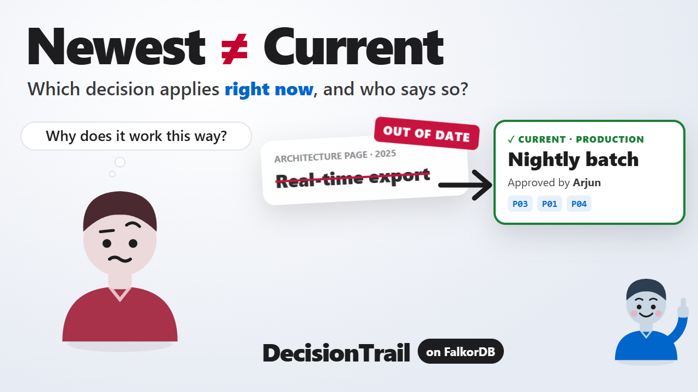

<h1 align="center">DecisionTrail</h1>
<p align="center">Why does this project currently do this? The answer, with proof.</p>

[](https://youtu.be/oExijE1rNvk)

<p align="center"><b><a href="https://youtu.be/oExijE1rNvk">▶ Watch the demo film (3 min)</a></b></p>

<p align="center"><sub>Graph Hacks · Company Brain · Built on FalkorDB</sub></p>

## The newest document isn't the answer.

A new engineer reads the architecture page: Harbor exports customer data in real time. Production
actually runs a nightly batch. DecisionTrail returns the decision that applies now, the reason,
the accountable owner, and the exact source passage behind every link.

## Current means approved and in scope.

- **Scope.** A replacement applies only where it was granted. Production can change while staging
  keeps the old decision.
- **Authority.** A newer note from someone without authority does not override an approved
  decision.
- **Time.** A decision can be approved now and take effect later.
- **Conflict.** If two equally authorized decisions both apply, the answer is CONFLICT. No
  tie-breaker is invented.
- **Proof.** A link counts only if its cited passage states it. A passage that only mentions two
  things does not connect them.

## FalkorDB decides. The model explains.

1. **Resolve.** One Cypher query walks from the environment to every decision in effect on the
   date.
2. **Check.** It keeps a decision only if its approver holds authority there, and every edge on
   the way is stated by its cited passage.
3. **Supersede.** It drops any decision that a valid newer one replaced in that same scope.
4. **Answer.** One result is an answer, two or more is a conflict, none is unknown. An optional
   agent explains the result; the server checks every id and citation it submits.

## Tested on held-out cases.

**12/12** held-out cases with the graph · **9/12** for a passage index with the same facts and
authority filter · **12/12 in both runs** for an agent using the graph tools, with zero
unsupported citations · [How it was measured](docs/EVALUATION.md)

## Run it.

```bash
docker run -d --name falkordb -p 6379:6379 falkordb/falkordb:latest
pip install -r requirements.txt
python gate.py           # feasibility gate, no model needed
python eval.py           # deterministic eval vs. oracle and baseline, no model needed
python server.py         # demo on http://localhost:8001
```

The agent needs `OPENAI_API_KEY` set in your environment. Run `python agent.py dev01 graph` for
one case.

---

## Reference

### Graph model

| Node | Meaning |
|---|---|
| `Project {id, name, aliases}` | A project, found by name or alias |
| `Scope {id, env}` | An environment of a project, such as production or staging |
| `Requirement {id, text}` | The question a decision answers, such as how data is exported |
| `Decision {id, title, from, to}` | A decision with its effective dates |
| `Person {id, name}` | Someone who approves or owns decisions |
| `Passage {id, doc, rev, text, claims}` | An exact source passage and the relations it states |

| Edge | From → to | Meaning |
|---|---|---|
| `APPLIES_TO` | Decision → Scope | The decision governs that environment |
| `ADDRESSES` | Decision → Requirement | The question it answers |
| `SUPERSEDES {scope}` | Decision → Decision | Replaces an older decision in one scope only |
| `APPROVED_BY` | Decision → Person | Who approved it |
| `AUTHORIZED_FOR {to, end}` | Person → Scope | Authority to approve there; can be ended by a later passage |
| `OWNED_BY {from}` | Decision → Person | Accountable owner from a date |
| `SUPPORTED_BY` | Decision → Passage | The rationale |

Every edge carries `src`, the id of the passage it came from. A query uses an edge only if that
passage's `claims` list contains it. All data is fictional and curated, in `fixture.json` and
`heldout.json`.

### Core query

Which decisions apply to a scope at a date (abridged; full text in `decisiontrail.py`):

```cypher
MATCH (s:Scope {id:$scope})<-[a:APPLIES_TO]-(d:Decision)-[ad:ADDRESSES]->(r:Requirement)
WHERE d.from <= $t AND (d.to IS NULL OR $t < d.to)
MATCH (d)-[b:APPROVED_BY]->(p:Person)-[z:AUTHORIZED_FOR]->(s)
// each edge must be stated by its cited passage
MATCH (ap:Passage) WHERE ap.id = a.src AND d.id+'|APPLIES_TO|'+s.id IN ap.claims
...
// drop decisions another admissible decision supersedes in this scope
OPTIONAL MATCH (d2:Decision)-[x:SUPERSEDES]->(d) WHERE x.scope = s.id AND d2.id IN ids
OPTIONAL MATCH (xp:Passage) WHERE xp.id = x.src AND d2.id+'|SUPERSEDES|'+d.id+'@'+s.id IN xp.claims
WITH row, d, count(xp) AS beaten WHERE beaten = 0
RETURN row.r.id AS req, d.id AS decision, row.ev AS evidence
```

Owner, rationale, the replaced decision and the full evidence trail are short supported-edge
queries in the same file.

### Agent

The model (default `gpt-5.4-mini`) acts only through six read-only tools: `resolve_project`,
`applicable_decisions`, `trace_rationale`, `resolve_owner`, `read_passage` and
`answer_or_abstain`. It cannot write Cypher. The server checks each submitted answer: ids must
exist, citations must be known passages, and the approver must hold authority for that
environment on that date. The checker does not reveal the right answer.

### Commands

```bash
python agent.py dev01 graph              # one agent run in the terminal
python agent_eval.py h01 h02 ... h13     # paired graph vs. flat agent runs (costs API credit)
```

### Limitations

Curated import only: no parser, connector or automatic extraction. Authority start dates are not
modeled. Passage support is an authored claims list; it proves the source states a relation, not
that the relation is true in the real world. Two projects and about twenty cases cannot show
general performance. Recursive SQL could run the same joins; the point is that FalkorDB holds the
connected state and returns paths you can inspect.

### AI disclosure

An AI coding assistant was used to generate and debug code and to draft documentation. At
runtime, an LLM (OpenAI `gpt-5.4-mini` by default) is the optional agent that explains answers;
the graph decides them. Every result reported here came from running the code in this repository.

### Files

`decisiontrail.py` graph model, queries and tools · `agent.py` tool-calling loop · `oracle.py`
independent reducer · `baseline.py` matched passage index · `gate.py` feasibility gate ·
`eval.py` deterministic eval · `agent_eval.py` paired agent runs · `server.py`, `static/` demo UI ·
`results/` raw eval records · `docs/EVALUATION.md` full eval history
